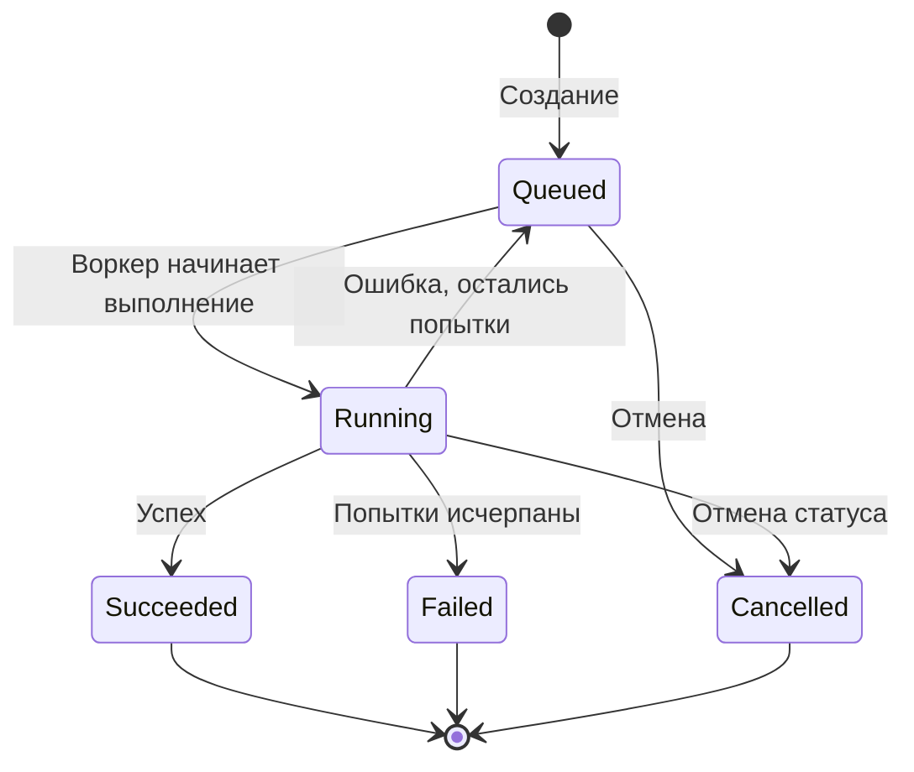

# ChronicleFlow

**ChronicleFlow** — лёгкий сервис для планирования и выполнения фоновых задач на **C# / .NET 10**. Он принимает задачи через HTTP API, выполняет их параллельно, поддерживает отложенный запуск и повторные попытки, а также восстанавливает состояние из локального журнала после перезапуска.

> Проект построен без внешнего брокера сообщений и отдельной базы данных: история изменений задач хранится в JSONL-файле.

## Возможности

- **HTTP API** для создания, просмотра, фильтрации и отмены задач.
- **Отложенный запуск** задач с помощью `runAt`.
- **Приоритеты выполнения**: сначала выбираются готовые задачи с более высоким `priority`.
- **Параллельная обработка** несколькими воркерами и ограниченная очередь на базе `System.Threading.Channels`.
- **Повторные попытки** при ошибках с экспоненциальной задержкой (до 60 секунд).
- **Идемпотентная отправка** по `idempotencyKey` для предотвращения повторного создания одной и той же задачи.
- **Сохранение истории состояний** в append-only JSONL-журнале и восстановление после перезапуска.
- **Метрики выполнения** через `System.Diagnostics.Metrics` и endpoint проверки работоспособности `/health`.
- **Контейнеризация** с Docker и модульные тесты на xUnit.

## Технологии

| Компонент | Технология |
| --- | --- |
| Язык и платформа | C#, .NET 10 |
| HTTP API | ASP.NET Core Minimal API |
| Выполнение задач | `BackgroundService`, `System.Threading.Channels` |
| Хранение | JSON Lines (JSONL), append-only журнал |
| Метрики | `System.Diagnostics.Metrics` |
| Тестирование | xUnit |
| Развёртывание | Docker |

## Быстрый старт

### Запуск локально

Понадобится установленный [.NET 10 SDK](https://dotnet.microsoft.com/download/dotnet/10.0).

```bash
git clone https://github.com/VladimirDonskov/ChronicleFlow.git
cd ChronicleFlow

dotnet restore
dotnet run --project src/ChronicleFlow.Api --launch-profile http
```

API будет доступен по адресу **http://localhost:5118**.

Для проверки:

```bash
curl http://localhost:5118/health
```

### Запуск через Docker

```bash
docker build -t chronicleflow .

docker run --rm \
  --name chronicleflow \
  -p 8080:8080 \
  -v chronicleflow-data:/app/data \
  chronicleflow
```

После запуска API доступен на **http://localhost:8080**. Именованный том `chronicleflow-data` позволяет сохранять журнал задач между перезапусками контейнера.

## Работа с API

### Создать задачу

`POST /jobs`

```bash
curl -X POST http://localhost:5118/jobs \
  -H "Content-Type: application/json" \
  -d '{
    "type": "echo",
    "payload": { "message": "Hello, ChronicleFlow!" },
    "priority": 5,
    "maxAttempts": 3,
    "idempotencyKey": "demo-echo-001"
  }'
```

В ответ API возвращает **`201 Created`**, заголовок `Location` и созданную задачу, включая её `id` и текущий статус.

Поля запроса:

| Поле | Описание | Значение по умолчанию |
| --- | --- | --- |
| `type` | Тип задачи, для которого зарегистрирован обработчик | Обязательное поле |
| `payload` | JSON-данные, передаваемые обработчику | — |
| `runAt` | Время начала выполнения в формате ISO 8601 | Текущее время |
| `priority` | Приоритет; чем больше число, тем выше приоритет | `0` |
| `maxAttempts` | Максимальное количество попыток выполнения (от 1 до 20) | `3` |
| `idempotencyKey` | Ключ для исключения дублирующей отправки | `null` |

В проекте зарегистрированы демонстрационные обработчики **`echo`**, **`delay`** и **`sha256`**. Для собственного типа задачи необходимо добавить реализацию `IJobHandler` и зарегистрировать её в DI.

### Получить список задач

`GET /jobs`

```bash
curl "http://localhost:5118/jobs?status=Queued&limit=20"
```

Оба параметра необязательны. `status` фильтрует задачи по состоянию, `limit` ограничивает число записей (от 1 до 500, по умолчанию — 100). Список сортируется по времени создания, от новых задач к старым.

### Получить задачу по ID

`GET /jobs/{id}`

```bash
curl http://localhost:5118/jobs/00000000-0000-0000-0000-000000000000
```

Замените GUID на фактический идентификатор из ответа `POST /jobs`. Если задача отсутствует, API возвращает `404 Not Found`.

### Отменить задачу

`POST /jobs/{id}/cancel`

```bash
curl -X POST http://localhost:5118/jobs/00000000-0000-0000-0000-000000000000/cancel
```

Запрос переводит подходящую задачу в состояние `Cancelled`. **Важно:** текущая реализация меняет состояние выполняющейся задачи, но не гарантирует немедленного прерывания уже запущенного обработчика.

### Проверить работоспособность

`GET /health`

```bash
curl http://localhost:5118/health
```

## Жизненный цикл задачи



Диспетчер проверяет готовые задачи приблизительно каждые **250 мс**. При ошибке задача повторно помещается в очередь с экспоненциальной задержкой: 1, 2, 4, 8 секунд и далее, максимум до 60 секунд. Если приложение перезапускается во время выполнения, незавершённые задачи со статусом `Running` восстанавливаются как `Queued`.

## Архитектура

Проект разделён на четыре основных слоя:

```text
ChronicleFlow/
├── src/
│   ├── ChronicleFlow.Api/             # HTTP endpoints, dispatcher, metrics
│   ├── ChronicleFlow.Application/     # Сценарии работы и интерфейсы
│   ├── ChronicleFlow.Domain/          # Модель задачи и её состояния
│   └── ChronicleFlow.Infrastructure/  # JSONL-хранилище и инфраструктура
├── tests/
│   └── ChronicleFlow.Tests/           # Модульные тесты xUnit
├── docs/
│   └── adr/                           # Архитектурные решения
├── Dockerfile
└── ChronicleFlow.slnx
```

**Порядок работы:** API передаёт запрос в `JobService`; сервис сохраняет задачу через `IJobStore`; фоновый `JobDispatcher` выбирает готовые задачи, распределяет их между воркерами и вызывает соответствующий `IJobHandler`. Все изменения состояния записываются в журнал.

## Конфигурация

Основные параметры задаются в `src/ChronicleFlow.Api/appsettings.json`:

```json
{
  "Jobs": {
    "LogPath": "data/jobs.jsonl",
    "QueueCapacity": 1000,
    "WorkerCount": 4
  }
}
```

| Параметр | Назначение |
| --- | --- |
| `Jobs:LogPath` | Путь к журналу задач |
| `Jobs:QueueCapacity` | Вместимость внутреннего канала задач |
| `Jobs:WorkerCount` | Число параллельно работающих воркеров |

Параметры ASP.NET Core можно переопределять переменными окружения с двойным подчёркиванием, например `Jobs__WorkerCount=8`.

## Тестирование

```bash
dotnet test ChronicleFlow.slnx
```

Тесты проверяют, в частности, повторные попытки, восстановление состояния из журнала и идемпотентность создания задач.

## Ограничения

ChronicleFlow в текущем виде ориентирован на **один экземпляр сервиса** и локальное файловое хранение. Это не распределённая очередь: для конкурентной работы нескольких экземпляров потребуется согласованное хранилище и механизм координации воркеров. Перед размещением в публичной сети также следует добавить аутентификацию и авторизацию API.

## Автор

[Vladimir Donskov](https://github.com/VladimirDonskov)
